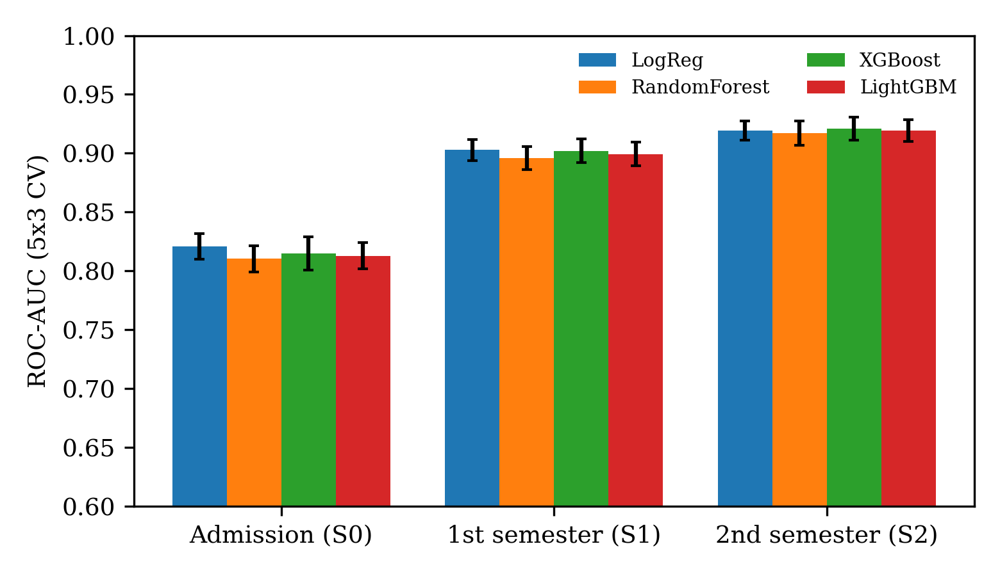
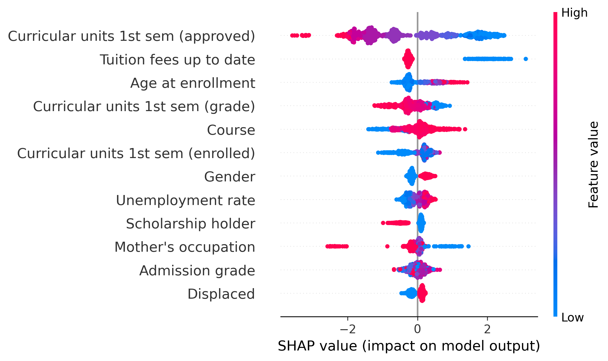

# Explainable Machine Learning for Early Prediction of Student Dropout

Code and results for the paper:

> **Michael Cabanillas-Carbonell.** *Explainable Machine Learning for Early Prediction of Student Dropout: A Stage-Wise SHAP Analysis on Open Academic Data.* International Conference on Artificial Intelligence and Data Engineering (ICAID 2027), Paris, France, March 17–19, 2027.

This repository contains a fully reproducible pipeline that predicts student dropout at three institutional decision points and explains the predictions with SHAP.

## Study design

| Stage | Information available | # features |
|---|---|---|
| **S0 – Admission** | Demographic, socioeconomic, prior education and admission grades, application, macroeconomic | 24 |
| **S1 – 1st semester** | S0 + first-semester curricular units | 30 |
| **S2 – 2nd semester** | S1 + second-semester curricular units | 36 |

- **Task:** binary classification, Dropout vs. Non-dropout (32.1% positive rate).
- **Models:** Logistic Regression (L2), Random Forest, XGBoost, LightGBM.
- **Validation:** stratified 80/20 hold-out split + repeated stratified 5-fold CV (×3) on the development set.
- **Statistics:** Friedman test (models within a stage) and Wilcoxon signed-rank test (consecutive stages).
- **Explainability:** SHAP TreeExplainer on the hold-out set.

## Data

*Predict Students' Dropout and Academic Success* — UCI Machine Learning Repository, id 697 (4,424 students, 36 predictors, CC BY 4.0).

> Realinho, V., Machado, J., Baptista, L., & Martins, M. V. (2022). Predicting Student Dropout and Academic Success. *Data*, 7(11), 146. https://doi.org/10.3390/data7110146

The dataset is **not** redistributed here; the script downloads it directly from UCI.

## How to run

### Google Colab
```python
!git clone https://github.com/mihaelcc/icaid2027-dropout-xai.git
%cd icaid2027-dropout-xai
!pip install -r requirements.txt
!python dropout_xai.py
```

### Local
```bash
git clone https://github.com/mihaelcc/icaid2027-dropout-xai.git
cd icaid2027-dropout-xai
pip install -r requirements.txt
python dropout_xai.py                 # downloads the data from UCI
python dropout_xai.py --csv data.csv  # or use a local copy
```

All outputs are written to `results/`. A fixed random seed (42) is used; small differences in the third decimal may appear with other library versions.

## Main results (hold-out set, n = 885)

| Stage | Best model (CV) | CV ROC-AUC | Test ROC-AUC | Recall (Dropout) |
|---|---|---|---|---|
| S0 Admission | Logistic Regression | 0.821 ± 0.011 | 0.838 | 0.715 |
| S1 1st semester | Logistic Regression | 0.903 ± 0.009 | 0.914 | 0.810 |
| S2 2nd semester | XGBoost | 0.921 ± 0.010 | 0.934 | 0.813 |

About 82% of the AUC gain achievable by the end of the first year is already obtained after the first semester. Differences among models are small (≤ 0.011 AUC) and not significant at S2 (Friedman p = 0.26).

<p align="center"></p>
<p align="center"></p>

## Repository structure

```
├── dropout_xai.py      # full experimental pipeline
├── requirements.txt    # Python dependencies
├── results/            # outputs of the run reported in the paper
│   ├── cv_folds.csv, cv_summary.csv, test_results.csv
│   ├── statistical_tests.json, dataset_info.json, confusion_S1.csv
│   ├── shap_importance_*.csv, shap_top10.json
│   └── fig_*.png
├── CITATION.cff
└── LICENSE (MIT)
```

## Citation

If you use this code, please cite the paper above (see `CITATION.cff`).

## Contact

Michael Cabanillas-Carbonell — Universidad Privada del Norte, Lima, Peru.
